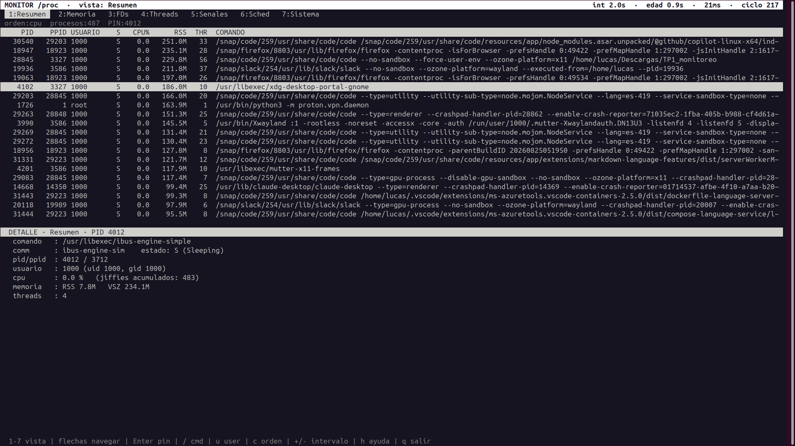
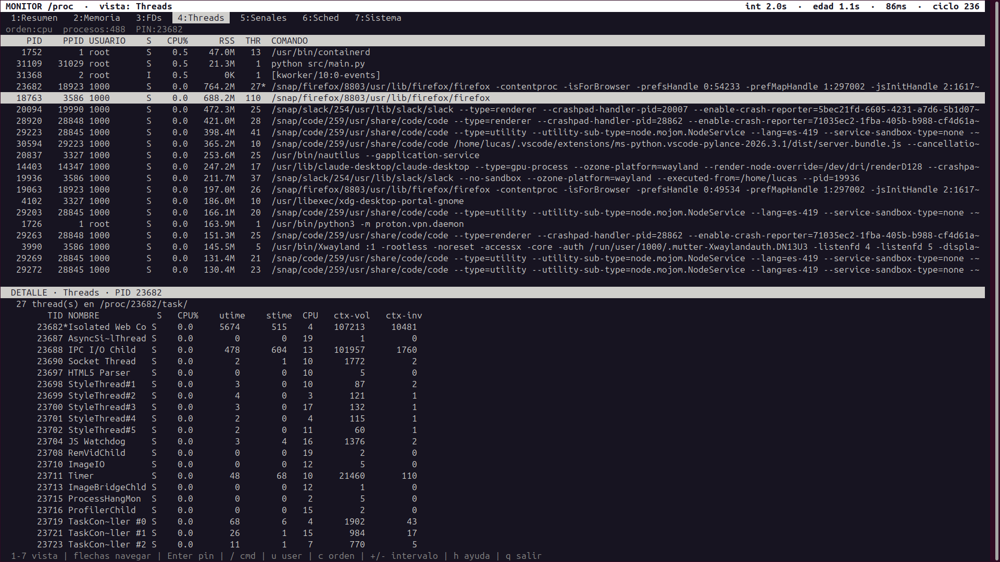
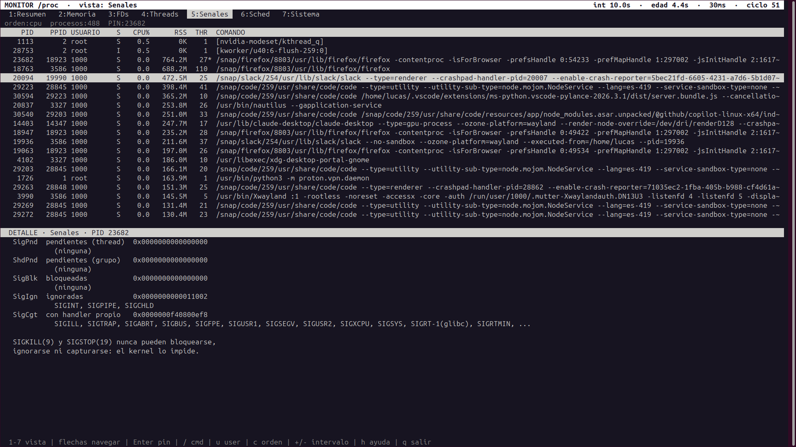

# TP1 — Monitor de Procesos y Threads

**Computación II — Universidad de Mendoza — 2026 Autor: Lucas Boschin**

Monitor del sistema en tiempo real, estilo `htop`, que lee **`/proc` directamente**
y no usa `psutil`, `subprocess` ni ninguna librería que abstraiga el kernel.
La arquitectura es **multiproceso**: 10 procesos independientes que se comunican
con primitivas de `multiprocessing`.

---

## 1. Descripción general

El monitor muestra dos paneles a la vez:

- **Arriba**: la lista de procesos vivos, con PID, PPID, usuario, estado, CPU%,
  RSS, cantidad de threads y comando completo. Se puede navegar, filtrar y
  reordenar.
- **Abajo**: el panel de detalle, que cambia según la vista activa (1 a 7) y
  muestra el proceso seleccionado (o el "pineado").

Cada vista se alimenta de un **analizador distinto**, que corre en su **propio
proceso** y con su **propio intervalo de refresco**. Es decir: la vista Resumen
se actualiza cada 2 segundos mientras la vista Señales lo hace cada 10, y ambas
cosas ocurren en paralelo sin que una espere a la otra.

### Cómo se usa

```bash
docker compose up --build
```

Y una vez adentro:

| Tecla | Acción |
|-------|--------|
| `1`–`7` o `r m f t s p g` | cambiar de vista |
| `↑` `↓` | navegar la lista de procesos |
| `PgUp` `PgDn` | saltar de a una página |
| `Enter` | pin/unpin del proceso seleccionado |
| `/` | filtrar por nombre de comando |
| `u` | filtrar por usuario |
| `c` | alternar orden: CPU% → RSS → PID |
| `+` / `-` | ajustar el intervalo de la vista activa (±0.5 s) |
| `h` / `?` | ayuda |
| `q` | salir limpiamente |

### Las 7 vistas

| # | Vista | Qué muestra | Intervalo default / mínimo |
|---|-------|-------------|---------------------------|
| 1 | Resumen | estado, CPU%, RSS, VSZ, threads, cmdline, uid/gid | 2 s / 0.5 s |
| 2 | Memoria | `Vm*`, page faults, segmentos agrupados de `maps` | 3 s / 1 s |
| 3 | FDs | lista de FDs con su destino y tipo inferido | 5 s / 2 s |
| 4 | Threads | LWPs con CPU%, estado, utime/stime, context switches | 2 s / 0.5 s |
| 5 | Señales | `SigPnd`/`ShdPnd`/`SigBlk`/`SigIgn`/`SigCgt` decodificadas | 10 s / 5 s |
| 6 | Scheduling | nice, priority, policy, RT prio, afinidad, ctx switches, SID/PGID | 10 s / 5 s |
| 7 | Sistema | CPU global, load, memoria, swap, uptime, totales, top-3 | 2 s / 1 s |

---

## 2. Arquitectura

```
                       proceso principal (main.py)
                       select() sobre el self-pipe
                       ┌──────────────────────────┐
      señales  ───────▶│  SIGINT SIGTERM SIGHUP   │
   (kill -SIG)         │  SIGUSR1 SIGUSR2 SIGWINCH│
                       └───────┬──────────────────┘
                               │ Pipe (avisos)
                               ▼
   ┌──────────────┐      ┌──────────────────────────────────────┐
   │  RECOLECTOR  │      │           SNAPSHOT GLOBAL            │
   │              │      │        (Manager.dict compartido)     │
   │ lista /proc  │      │  resumen    : {datos, ts, ms, ciclos} │
   │ cada 2 s     │      │  memoria    : {...}                   │
   └──────┬───────┘      │  fds        : {...}                   │
          │              │  threads    : {...}                   │
   Queue(maxsize=4)      │  senales    : {...}                   │
   una por analizador    │  scheduling : {...}                   │
   (fan-out de PIDs)     │  sistema    : {...}                   │
          │              └────────▲──────────────────┬──────────┘
          │                       │ escribe          │ lee
          │              ┌────────┴───────┐   ┌──────▼────────┐
          │              │   AGREGADOR    │   │   DISPLAY     │
          │              │ único escritor │   │  TUI (curses) │
          │              └────────▲───────┘   │  vista activa │
          │                       │           └───────┬───────┘
          │              Queue de resultados          │
          │              (todos → uno)                │
   ┌──────┴───────────────────────┴──────────┐        │
   │                                          │        │
┌──▼─────┐┌────────┐┌─────┐┌───────┐┌───────┐┌▼──────┐┌▼───────┐
│resumen ││memoria ││ fds ││threads││senales││ sched ││sistema │
│  2 s   ││  3 s   ││ 5 s ││  2 s  ││ 10 s  ││ 10 s  ││  2 s   │
└────────┘└────────┘└─────┘└───────┘└───────┘└───────┘└────────┘
        7 analizadores, cada uno un PROCESO independiente
        cada uno lee /proc por su cuenta, a su propio ritmo

                    ▲                                   │
                    └───── Value('d') por vista ─────────┘
                       (el display escribe con +/-,
                        el analizador lee cada ciclo)
```

**Total: 10 procesos** (main + recolector + agregador + 7 analizadores + display,
más el proceso interno del `Manager`).

### Flujo de un dato

1. El **recolector** lista `/proc`, saca los PIDs vivos y publica la lista en
   las 7 `Queue` (una por analizador).
2. Cada **analizador** toma la última lista publicada, lee los archivos de
   `/proc` que le corresponden y arma su diccionario.
3. El analizador empuja `{seccion, datos, ts, ms}` a la **Queue de resultados**.
4. El **agregador** —único consumidor— aplica ese mensaje al `Manager.dict`
   escribiendo la clave de golpe.
5. El **display** copia la sección que necesita y la renderiza.

---

## 3. Decisiones de diseño

### 3.1 ¿Por qué procesos y no threads para los analizadores?

El trabajo de los analizadores es **abrir cientos de archivos y parsearlos en
Python**. El parseo es bytecode puro: CPU-bound. Con threads, el **GIL** los
serializaría y no habría paralelismo real — los 7 "paralelos" se turnarían para
ejecutar bytecode, y el tiempo total sería la suma, no el máximo.

Con procesos cada uno tiene su propio intérprete y su propio GIL, y el scheduler
del kernel los reparte entre cores. Esto es exactamente lo que vimos en la clase
10: el GIL no impide el paralelismo de I/O, pero sí el de CPU, y este caso es
mixto con una parte de CPU importante.

El único lugar donde el TP permite threads es el display, y ni siquiera lo
necesité: `curses` con `timeout(200)` ya da entrada de teclado no bloqueante.

### 3.2 ¿Por qué `Manager.dict` para el snapshot y no `Value`/`Array`?

`Value` y `Array` viven en **memoria compartida real** (`mmap` con `MAP_SHARED`,
clase 7). Son rapidísimos porque no hay copia ni serialización: el mismo segmento
de memoria física está mapeado en varios espacios de direcciones. Pero exigen
**tipos C de tamaño fijo declarados de antemano** (`'d'`, `'i'`, `'b'`, o un
array de N elementos de esos tipos).

El snapshot no es nada de eso: es un diccionario de diccionarios de tamaño
variable y forma heterogénea. Un proceso puede tener 3 FDs y otro 400; los PIDs
aparecen y desaparecen entre ciclos; la vista de señales guarda listas de strings.
No hay forma sensata de embutir eso en un `Array` de tamaño fijo.

`Manager.dict` resuelve esto: es un **proxy** a un diccionario que vive en un
proceso servidor aparte. Cada acceso es un round-trip IPC con pickle. Es mucho
más lento, pero soporta cualquier estructura serializable.

**Uso los dos, cada uno donde corresponde:**

| Dato | Primitiva | Motivo |
|------|-----------|--------|
| Snapshot completo | `Manager.dict` | estructura anidada y variable |
| Intervalo de cada vista | `Value('d')` | un double, se escribe muy seguido con `+`/`-` |
| Flag verbose | `Value('b')` | un byte, lo leen los 7 analizadores |
| Flag de apagado | `Event` | booleano + semántica de espera |

Como `Manager.dict` es caro, el display **copia la sección entera una sola vez por
frame** (`dict(self.seccion("resumen")["datos"])`) en vez de acceder al proxy
dentro del loop de dibujo. Iterar 300 procesos accediendo al proxy en cada
iteración serían 300 round-trips IPC por frame, a 5 frames por segundo.

### 3.3 ¿Cómo manejo las race conditions?

Tres mecanismos, en orden de importancia:

**a) Patrón single-writer (el principal).**
Los 7 analizadores **no escriben el snapshot**. Empujan sus resultados a una
única `Queue` y el **agregador** es el único proceso que toca el `Manager.dict`.
La `Queue` ya serializa los mensajes internamente (tiene su propio lock y su
thread alimentador), así que las escrituras quedan ordenadas *por construcción*.
No hace falta un `Lock` explícito y, mejor todavía, los analizadores nunca se
bloquean esperándose entre sí.

Sin esto, la race clásica sería: dos analizadores hacen
`snapshot["x"] = snapshot["x"] + algo` a la vez y uno pisa al otro (read-modify-write
no atómico sobre un proxy).

**b) Escritura de la clave completa, nunca parcial.**
El agregador hace `snapshot["memoria"] = {...}` de una sola vez. **Nunca** hace
`snapshot["memoria"]["pid_123"] = ...`, que sobre un proxy ni siquiera se
propagaría correctamente (el sub-dict es una copia local). Como consecuencia, el
display jamás ve una sección a medio actualizar: o está la versión vieja completa
o la nueva completa.

**c) `Value` con su lock implícito.**
`multiprocessing.Value("d", ...)` viene con un `RLock` por defecto. Cuando el
display escribe `v.value = 1.5` y el analizador lee `float(self.intervalo.value)`,
el lock garantiza que nadie lea un double a medio escribir (en x86-64 un double
alineado es atómico igual, pero no quiero depender de la arquitectura).

**Race que NO intento eliminar, porque es inherente a `/proc`:** entre que el
recolector lista los PIDs y que un analizador abre `/proc/<pid>/status`, el
proceso puede haber muerto. Es un TOCTOU imposible de evitar sin cooperación del
kernel. La estrategia es defensiva: toda función de `procfs.py` devuelve `None`
ante `OSError` y el analizador simplemente saltea ese PID. Por eso las secciones
suelen tener uno o dos procesos menos que la lista original.

### 3.4 ¿Por qué esos intervalos por defecto?

El criterio es la **tasa de cambio del dato contra el costo de leerlo**:

- **Resumen (2 s)** y **Threads (2 s)**: el CPU% es un delta; con intervalos muy
  cortos el número salta porque un jiffy (10 ms con `HZ=100`) pesa demasiado en
  la fracción. A 2 s hay ~200 jiffies de resolución, que da un número estable.
- **Sistema (2 s)**: mismo argumento para el delta de `/proc/stat`.
- **Memoria (3 s)**: `RSS` cambia rápido pero `/proc/<pid>/maps` es caro — un
  proceso con muchas librerías tiene cientos de líneas, y hay que parsearlas todas.
- **FDs (5 s)**: requiere un `readlink()` por cada FD de cada proceso. Es la vista
  con más syscalls por ciclo, y los FDs no cambian tanto.
- **Señales (10 s)** y **Scheduling (10 s)**: la máscara de señales de un proceso
  se define al arrancar y prácticamente no cambia; el `nice` y la policy tampoco.
  Refrescarlos rápido sería gastar CPU para ver el mismo número.

Los **mínimos** están en `config.json` y los impone el display al ajustar con
`+`/`-`, para que no se pueda poner FDs en 0.1 s y saturar el sistema.

### 3.5 ¿Por qué `Queue` en un sentido y `Pipe` en el otro?

- **Recolector → analizadores**: `Queue`, porque es fan-out (una por analizador),
  necesito `maxsize` para no acumular listas viejas, y `Queue` maneja el locking
  multi-productor/multi-consumidor solo.
- **Analizadores → agregador**: `Queue`, porque son 7 productores y 1 consumidor.
  Un `Pipe` no es seguro con múltiples escritores concurrentes para mensajes
  grandes (`> PIPE_BUF` deja de ser atómico y los mensajes se entrelazan).
- **Main → display**: `Pipe`. Son mensajes raros, chicos, un solo escritor y un
  solo lector. No necesito la maquinaria de `Queue` (que internamente es un pipe
  + un thread alimentador + locks): un `Pipe` pelado es más barato y más directo.

Las queues de PIDs son **acotadas y con `put_nowait()`**: si un analizador lento
no consume, prefiero descartar la lista vieja antes que bloquear al recolector y
frenar a los otros seis.

### 3.6 Manejo de señales: self-pipe

Un handler de señal corre de forma **asincrónica**, interrumpiendo al proceso en
cualquier instrucción. Si adentro del handler abro un archivo, tomo un lock o
toco el `Manager`, puedo re-entrar en una función que ya estaba a medio ejecutar
(`malloc` es el ejemplo típico) y dejar el proceso corrupto o deadlockeado.

Por eso uso el patrón **self-pipe** (clase 6): lo único que hace el handler es un
`os.write()` de **un byte** sobre el extremo de escritura de un pipe. `write()` es
async-signal-safe y un write de 1 byte está muy por debajo de `PIPE_BUF`, así que
es atómico.

El loop principal hace `select()` sobre el extremo de lectura. Cuando llega el
byte, procesa la señal **de forma sincrónica, en un punto seguro** del programa:
ahí sí puede abrir el archivo de dump, releer `config.json` o mandar por el `Pipe`.

```
kill -USR1 <pid>
      │
      ▼
  handler ──── os.write(w, b"1") ───▶ [ pipe ] ───▶ select() en el loop principal
  (1 syscall,                                              │
   nada más)                                               ▼
                                              json.dump(snapshot, ...)  ← seguro
```

### 3.7 Señales de los hijos

Los hijos **ignoran** SIGINT, SIGHUP, SIGUSR1 y SIGUSR2 (`senales.ignorar_en_hijo()`).

El motivo: cuando el usuario aprieta Ctrl+C, la terminal manda SIGINT a **todo el
process group del foreground**, no solo al padre. Si cada hijo la manejara por su
cuenta morirían todos en desorden, dejando queues a medio vaciar y el `Manager`
huérfano. En cambio la maneja **solo el padre**, que ordena el apagado por el
`Event` compartido y hace los `join()` en orden.

SIGTERM sí se deja en su disposición por defecto, para poder matar un analizador
a mano y ver qué pasa (spoiler: el monitor sigue funcionando, esa sección se
congela y la "edad" del dato en el header empieza a crecer).

### 3.8 ¿Por qué `curses` y no `rich`?

1. **Cero dependencias**: `curses` es stdlib, así que el `requirements.txt` está
   vacío y el Dockerfile no depende de PyPI.
2. **Teclado**: `curses` ya trae `getch()` no bloqueante con `timeout()`, y decodifica
   solo las teclas especiales (`KEY_UP`, `KEY_NPAGE`, `KEY_RESIZE`). Con `rich`
   tendría que sumar `prompt_toolkit` o manosear `termios` a mano para poner la
   terminal en modo raw.
3. **Redibujado diferencial**: `curses` mantiene una pantalla virtual y solo manda
   al terminal las celdas que cambiaron. Repintar 40×130 caracteres 5 veces por
   segundo sin eso se nota.

El costo es que `curses` es más verboso y hay que calcular las posiciones a mano.

---

## 4. Conceptos del curso aplicados

**Clase 3 — Procesos: anatomía y `/proc`.**
Todo `procfs.py`. El caso más lindo es el parseo de `/proc/<pid>/stat`: el campo 2
(`comm`) viene entre paréntesis y **puede contener espacios y hasta paréntesis**
(`(mi (raro) proc)`). Un `split()` a secas desalinea todos los campos siguientes.
Por eso `leer_stat()` recorta usando el **último** `)` antes de hacer el split, y
hay un test específico para ese caso (`test_stat_con_parentesis_en_comm`).

**Clase 3 — Memoria virtual.**
La vista Memoria muestra la diferencia entre `VmSize` (espacio de direcciones
**reservado**) y `VmRSS` (páginas **realmente residentes** en RAM). En el monitor
se ve clarísimo: un proceso Python tiene ~100 MB de VmSize y ~17 MB de RSS.
`VmHWM` es el pico histórico de RSS, útil para ver si un proceso ya usó mucha
memoria aunque ahora esté tranquilo.

**Clase 4 — fork, exec, wait, zombies.**
La vista Sistema cuenta los zombies filtrando por `State == 'Z'` en
`/proc/<pid>/stat`. Un zombie es un proceso que ya terminó pero cuyo padre todavía
no llamó a `wait()`: el kernel le liberó toda la memoria pero mantiene la entrada
en la tabla de procesos para guardar el exit status. Por eso un zombie tiene
`VmRSS = 0` pero sigue apareciendo en `/proc`. En la TUI se resaltan en negrita.

También se ve el **COW** de `fork()` en los page faults: los `minflt` de los hijos
se disparan justo después del arranque, cuando empiezan a escribir sobre las
páginas compartidas con el padre y el kernel las duplica.

**Clase 5 — Pipes y file descriptors.**
La vista FDs es literalmente esto. Corriendo el monitor sobre sí mismo se ven los
pipes que crea `multiprocessing`: cada `Queue` aparece como un par de FDs
`pipe:[inodo]`, y los dos extremos del mismo pipe comparten el número de inodo.
También se ve el self-pipe de señales, y que los FDs 0/1/2 apuntan a `/dev/pts/N`
en el proceso del display pero no en los analizadores (porque `multiprocessing`
les redirige stdin a `/dev/null` — de hecho por eso tengo que `dup()` stdin antes
del fork para que `curses` funcione).

**Clase 6 — Señales.**
Dos lugares. Primero, el **manejo**: self-pipe + `select()`, explicado arriba.
Segundo, la **vista Señales**, que decodifica las máscaras hexadecimales de 64
bits de `/proc/<pid>/status`. El bit N-1 prendido significa que la señal N está en
ese conjunto:

```python
valor = int("0000000000001000", 16)     # SigIgn
for bit in range(64):
    if valor & (1 << bit):
        print(NOMBRES_SENAL[bit + 1])   # → SIGPIPE (señal 13, bit 12)
```

Corriendo el monitor sobre sí mismo se verifica el diseño de la sección 3.7:
los analizadores muestran `SigIgn = SIGHUP, SIGINT, SIGUSR1, SIGUSR2` y el
proceso principal muestra esas mismas señales en `SigCgt` (con handler propio).
También se comprueba que SIGKILL(9) y SIGSTOP(19) **nunca** aparecen en `SigIgn`
ni en `SigCgt`: el kernel no permite bloquearlas, ignorarlas ni capturarlas.

**Clase 7 — mmap y memoria compartida.**
Los `Value('d')` de los intervalos y el `Value('b')` de verbose. Están respaldados
por un `mmap` anónimo con `MAP_SHARED`, heredado por los hijos en el `fork()`. Es
memoria compartida de verdad: cuando el display escribe `v.value = 1.5`, el
analizador lo ve en su siguiente ciclo sin que haya viajado ningún mensaje.

**Clase 8 — Multiprocessing: `Process`, `Queue`, `Pipe`.**
La estructura completa de `main.py`. Un detalle que me costó: se pasa la **clase**
del analizador y no una instancia a `Process(target=...)`, para que el objeto se
construya del lado del hijo (`analizadores/base.py::arrancar`). Con el método de
arranque `spawn` una instancia con estado interno tendría que picklearse entera.

**Clase 9 — `Manager`, `Value`, `Array`.**
La discusión de la sección 3.2 sobre qué primitiva usar para qué.

**Clase 10 — Threading y el GIL.**
Dos veces. La justificación de usar procesos y no threads (sección 3.1), y la
**vista Threads**, que muestra que en Linux un thread es un **LWP**: una tarea
planificable más, con su propio TID y su propio directorio en
`/proc/<pid>/task/<tid>/` con la misma estructura que un proceso. El "proceso" que
ve el usuario es el **thread group**, y su TGID coincide con el TID del thread
líder (marcado con `*` en la TUI). Un proceso Python multihilo muestra sus threads
ahí, y se ve que el `utime` acumulado se reparte de forma desigual: el GIL hace
que casi todo el tiempo de CPU se lo lleve uno solo.

**Clase 11 — Sincronización.**
El patrón single-writer de la sección 3.3, que es sincronización *por diseño de
flujo de datos* en vez de por locks. La idea es que si solo hay un escritor, no
hay nada que sincronizar.

---

## 5. Limitaciones conocidas

1. **CPU% del primer ciclo es 0.** El cálculo necesita dos lecturas para hacer el
   delta de jiffies. Durante los primeros ~2 segundos toda la columna CPU% está
   en cero. No lo "arreglo" inventando un valor: un delta contra el boot time
   daría el promedio de toda la vida del proceso, que no es lo que se quiere ver.

2. **CPU% relativo a un core.** Igual que `top`, un proceso con 4 threads
   saturando 4 cores muestra ~400%. Es intencional pero desorienta la primera vez.

3. **Sin root, los FDs de procesos ajenos no se leen.** `os.readlink()` sobre
   `/proc/<otro_pid>/fd/N` da `EACCES`. La vista lo informa explícitamente en vez
   de mostrar una lista vacía sin explicación. Dentro del contenedor corremos como
   root, así que en la práctica se ve todo.

4. **`/proc/<pid>/maps` es la parte más cara.** Un proceso con muchas librerías
   tiene cientos de líneas y las parseo todas, para todos los procesos, cada 3
   segundos. Con >500 procesos la vista Memoria empieza a tardar (se ve en el
   contador de `ms` del header). No implementé cacheo por `starttime`, que sería
   la mejora obvia: los segmentos de un proceso viejo casi no cambian.

5. **Escalabilidad del snapshot.** Cada ciclo serializa el diccionario completo
   de una sección y lo manda por la Queue al agregador. Con 100 procesos son
   ~200 KB por ciclo, aceptable. Con varios miles el pickle empieza a pesar. La
   solución correcta sería mandar solo los deltas, pero complica bastante y no me
   dio el tiempo.

6. **Corte por límite en FDs y threads.** Sin verbose se guardan hasta 24 FDs y 32
   threads por proceso, para no inflar el snapshot. `SIGUSR2` sube los límites a
   200 y sin límite respectivamente. La TUI aclara cuántos se están mostrando
   sobre el total real.

7. **`ps` cuenta los kernel threads y yo también.** Aparecen `[kthreadd]`,
   `[kworker/...]` etc. con `cmdline` vacío. Los muestro entre corchetes (igual
   que `ps`) en vez de filtrarlos, porque forman parte de lo que hay en `/proc`.

8. **La TUI necesita al menos ~90 columnas.** Con menos, las líneas se truncan
   con `~` y algunas tablas del detalle quedan feas. No implementé un layout
   alternativo para terminales angostas.

9. **SIGWINCH funciona pero es redundante.** `curses` ya devuelve `KEY_RESIZE` por
   `getch()` y yo lo manejo por ahí; el handler de SIGWINCH manda un mensaje
   adicional de repintado. Lo dejé porque la consigna lo pide, pero en la práctica
   el resize ya andaba sin él.

10. **Si muere el agregador, el snapshot se congela en silencio.** El monitor no
    se cae, pero todas las vistas quedan con la misma "edad" creciendo. Detecto la
    muerte del display (y ahí apago todo) pero no relanzo componentes caídos.

---

## 6. Cómo correr y testear

### Con Docker (forma recomendada)

```bash
git clone <este-repo>
cd TP1_monitoreo
docker compose up --build
```

`tty: true` y `stdin_open: true` son **obligatorios**: sin ellos `curses` no
encuentra una terminal y la TUI no arranca.

`pid: host` en el `docker-compose.yml` hace que el contenedor comparta el PID
namespace del host, así que el monitor ve **todos** los procesos de la máquina.
Si se comenta esa línea, el monitor funciona igual pero solo lista los procesos de
adentro del contenedor (que son unos 10, todos del propio monitor — que en
realidad es un buen ejercicio para verlo monitorearse a sí mismo).

### Sin Docker

```bash
python3 src/main.py            # necesita Linux y Python 3.11+
```

### Probar las señales

En otra terminal, con el PID del proceso principal (`ps aux | grep main.py`, es el
padre de todos los demás):

```bash
kill -HUP  <pid>    # recarga config.json → aviso en el pie de la TUI
kill -USR1 <pid>    # escribe dump_<timestamp>.json con el snapshot completo
kill -USR2 <pid>    # toggle verbose → aparece "VERBOSE" en el header
kill -TERM <pid>    # apagado ordenado
```

Para probar SIGHUP: editar `config.json`, poner `"senales": 3.0`, mandar el HUP y
mirar cómo cambia el `int` del header al pasar a la vista 5.

### Modo headless (útil para debug sin terminal)

```bash
python3 src/main.py --sin-tui --volcar --segundos=15
```

Corre toda la arquitectura sin `curses` e imprime un resumen del sistema por
segundo. Sirve para verificar que los 7 analizadores están produciendo datos, y
para probar señales cuando no hay tty.

### Tests

```bash
python3 tests/test_procfs.py      # sin dependencias
python3 -m pytest tests/ -q       # si tenés pytest
```

17 tests que cubren el parseo puro (máscaras de señales, tipos de FD, el caso
patológico del `comm` con paréntesis) y la lectura real contra el proceso del
propio test.
### Capturas

**Vista 1 — Resumen.** Lista de procesos ordenada por CPU%, con el detalle del
proceso pineado abajo.



**Vista 4 — Threads.** Los 27 LWPs de un proceso de Firefox leídos de
`/proc/23682/task/`. Se ven los nombres reales de cada thread (`StyleThread#1`,
`JS Watchdog`, `IPC I/O Child`), el thread líder marcado con `*` — su TID
coincide con el PID del thread group — y los context switches voluntarios contra
los involuntarios. El thread `Timer` tiene 21460 voluntarios contra 110
involuntarios: se bloquea esperando, no consume CPU.



**Vista 5 — Señales.** Las máscaras hexadecimales de `/proc/<pid>/status`
decodificadas a nombres. Se comprueba que ni SIGKILL ni SIGSTOP aparecen en
`SigIgn` ni en `SigCgt`.



### Qué mirar para convencerse de que funciona

- Poner la vista 4 (Threads) sobre un proceso multihilo y ver los TIDs, con el
  líder marcado.
- Poner la vista 5 (Señales) sobre un analizador del propio monitor: debería
  mostrar `SigIgn = SIGHUP, SIGINT, SIGUSR1, SIGUSR2`.
- Vista 3 (FDs) sobre el proceso principal: se ven todos los pipes de las Queues
  de `multiprocessing`, con los dos extremos compartiendo inodo.
- Apretar `+` varias veces en la vista 5 y ver que se frena en 5.0 s (el mínimo).
- Matar un analizador con `kill -TERM` y ver que el monitor sigue vivo y esa
  sección se congela (la "edad" del header crece).

---

## 7. Estructura del repo

```
.
├── README.md                  ← este informe
├── dudas.md                   ← lo que me quedó sin resolver
├── Dockerfile
├── docker-compose.yml
├── requirements.txt           ← vacío: solo stdlib
├── config.json                ← intervalos default y mínimos
├── src/
│   ├── main.py                ← orquestador, self-pipe, apagado ordenado
│   ├── recolector.py          ← lista /proc y hace fan-out de PIDs
│   ├── agregador.py           ← único escritor del snapshot
│   ├── procfs.py              ← todo el parseo de /proc a mano
│   ├── senales.py             ← self-pipe y política de señales de los hijos
│   ├── display.py             ← TUI con curses, 7 vistas
│   └── analizadores/
│       ├── base.py            ← loop común, ritmo propio, aislamiento de errores
│       ├── resumen.py         ├── memoria.py    ├── fds.py
│       ├── threads.py         ├── senales.py    ├── scheduling.py
│       └── sistema.py
└── tests/
    └── test_procfs.py
```

---

## 8. Lo que aprendí

Lo que más me sorprendió fue **cuánto se ve de la propia implementación de
`multiprocessing`** cuando el monitor se apunta a sí mismo. Cada `Queue` es un par
de FDs `pipe:[inodo]`, y como los dos extremos comparten el inodo se puede
reconstruir el grafo de comunicación entero desde la vista FDs. También descubrí
por accidente que `multiprocessing` le redirige stdin a `/dev/null` a los hijos:
lo vi primero en la vista FDs (el display tenía `/dev/null` en el fd 0 en vez de
`/dev/pts/0`) y recién después entendí por qué `curses` no me leía el teclado. La
solución fue duplicar stdin **antes** del fork y hacer `dup2()` del lado del hijo.

El segundo aprendizaje fue sobre **sincronización sin locks**. Mi primer diseño
tenía los 7 analizadores escribiendo el `Manager.dict` directamente, con un `Lock`
compartido. Andaba, pero era lento (los analizadores se peleaban por el lock) y
frágil. Pasar al patrón single-writer —todos empujan a una Queue, uno solo escribe—
eliminó el lock por completo y quedó más rápido y más fácil de razonar. La lección
es que muchas veces la mejor primitiva de sincronización es **rediseñar el flujo de
datos para que no haya nada que sincronizar**.

Lo tercero, más chico pero muy concreto: **`/proc` es una API hostil si uno confía
demasiado**. El campo `comm` con paréntesis adentro me desalineó todos los campos
de `stat` y tardé un rato largo en darme cuenta de que el problema no era mi
indexación sino el `split()`. Y el TOCTOU entre listar los PIDs y leerlos es
irreducible: hay que aceptar que un proceso puede evaporarse en el medio y
programar defensivamente en cada lectura. Terminé con `procfs.py` devolviendo
`None` en todas partes y los analizadores salteando lo que no pudieron leer, que
es feo pero es la única forma honesta de hacerlo.

Lo último fue un bug de teclado que me costó encontrar porque el síntoma
engañaba. Las teclas especiales no mandan un carácter: mandan una secuencia de
escape (`ESC [ A` para ↑). Mi primera versión tenía `nodelay(True)`, que pone
`getch()` en modo totalmente no bloqueante — al leer el `ESC`, ncurses no espera
los bytes que faltan y devuelve el `ESC` suelto, así que las flechas nunca se
decodificaban. Lo que me despistó fue que los números y las letras sí andaban
(son un byte solo) y que el `^[O` aparecía impreso sobre la pantalla, lo que me
hizo pensar en un problema de Docker y no de mi código. La solución fue dejar
solo `timeout(200)`, que da una espera acotada pero permite que ncurses junte la
secuencia completa, más `keypad(True)` para que la traduzca a `KEY_UP`/`KEY_DOWN`.
De paso entendí por qué `docker compose up` no le pasa el teclado al contenedor
(deja la terminal en modo canónico) y `docker attach` sí (la pone en modo raw).